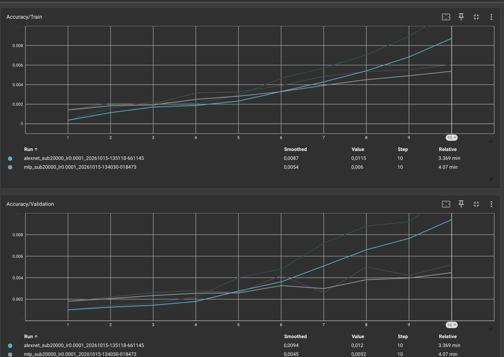
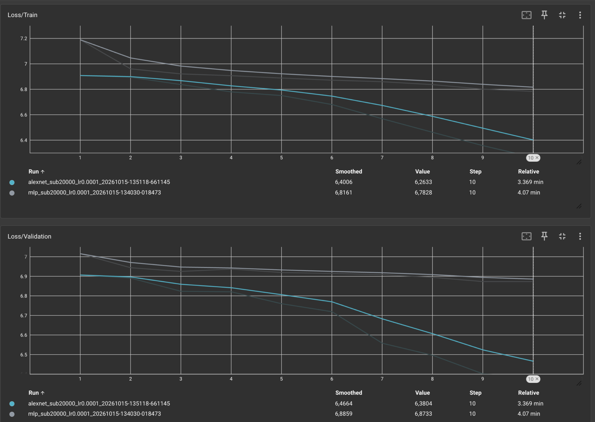
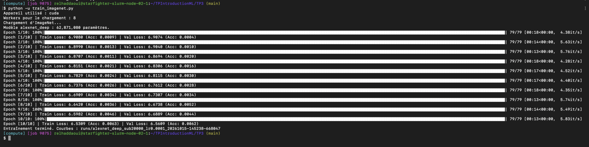
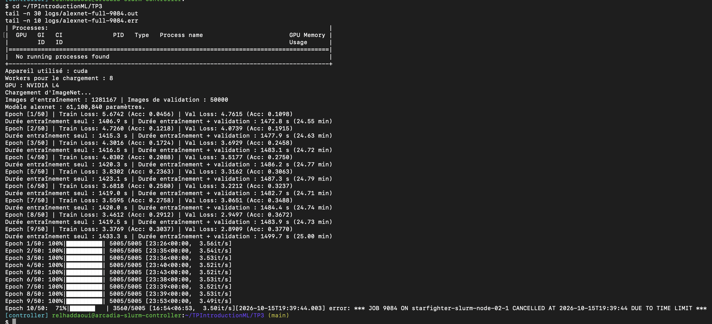

# TP3 : Réseaux convolutifs sur ImageNet

## Exercice 1 : Préparation des images

### Question 1 : Que se passe-t-il sans normalisation ? Pourquoi calculer les statistiques uniquement sur l’entraînement ?

**Réponse :** On normalise les images pour faciliter l’apprentissage. Sans ça, le réseau peut quand même apprendre, mais il peut mettre plus de temps ou apprendre de manière moins stable.

La normalisation applique, pour chaque couleur :

**Valeur normalisée = (valeur du pixel − moyenne) / écart-type.**

En gros, ça permet de centrer les valeurs et de les mettre sur une même échelle. Dans notre TP, `ToTensor()` met déjà les valeurs entre 0 et 1. Donc, si on oublie la normalisation, ça ne veut pas forcément dire que le réseau ne pourra plus apprendre.

On calcule la moyenne et l’écart-type seulement sur les images qui servent à l’entraînement. Ensuite, on utilise ces mêmes valeurs pour les images d’entraînement et de validation. On ne les recalcule pas sur la validation, sinon des informations de ces images serviraient déjà à préparer l’apprentissage : ce serait une fuite d’information. La validation doit servir à vérifier ce que le réseau a appris. Dans ce TP, les moyennes et les écarts-types sont déjà donnés dans le code.

### Question 2 : Pourquoi utiliser des transformations aléatoires pour l’entraînement et fixes pour la validation ?

**Réponse :** Pendant l’entraînement, on utilise des transformations aléatoires pour montrer plusieurs versions d’une image au réseau. `RandomResizedCrop` prend une partie de l’image au hasard et la redimensionne. `RandomHorizontalFlip` retourne parfois l’image comme dans un miroir. Comme ça, le réseau apprend à reconnaître un objet même si sa présentation change.

Pour la validation, on veut vérifier ses progrès dans les mêmes conditions. On utilise donc `Resize` pour redimensionner l’image et `CenterCrop` pour garder la partie au centre. Comme les transformations restent les mêmes, on peut comparer les résultats d’une époque à l’autre.

### Question 3 : Dans quel cas le miroir horizontal peut-il fausser une étiquette ?

**Réponse :** Par exemple, si on veut reconnaître des flèches gauche et droite, le miroir transforme une flèche gauche en flèche droite. Mais si on garde l’étiquette « gauche », la réponse donnée au réseau est fausse.

## Exercice 2 : MLP et AlexNet

### Étape 1 : MLP

#### Question 1 : Combien de paramètres possède le MLP, avec et sans biais ? Quelle couche en concentre plus de 99 % ?

**Réponse :** À l’entrée, on a les valeurs des couleurs de l’image, soit 3 × 227 × 227 = **154 587 valeurs**. Ensuite, on a une première couche cachée de 256 neurones, une deuxième de 256 et une sortie de 1 000 neurones pour les 1 000 classes.

Pour compter les poids, on multiplie le nombre d’entrées par le nombre de neurones de la couche. Ensuite, on ajoute un biais par neurone :

- Première couche cachée : 154 587 × 256 = **39 574 272 poids**, puis + 256 biais = **39 574 528 paramètres**.
- Deuxième couche cachée : 256 × 256 = **65 536 poids**, puis + 256 biais = **65 792 paramètres**.
- Couche de sortie : 256 × 1 000 = **256 000 poids**, puis + 1 000 biais = **257 000 paramètres**.

| Couche | Poids | Biais | Total |
|---|---:|---:|---:|
| 154 587 → 256 | 39 574 272 | 256 | 39 574 528 |
| 256 → 256 | 65 536 | 256 | 65 792 |
| 256 → 1000 | 256 000 | 1000 | 257 000 |
| Total | **39 895 808** | **1 512** | **39 897 320** |

Le total est donc **39 895 808 paramètres sans biais** et **39 897 320 avec biais**. La première couche cachée concentre **99,19 %** des paramètres, car chaque neurone reçoit toutes les valeurs de l’image. ReLU n’ajoute aucun paramètre.

#### Question 2 : Quel est le défaut du MLP lorsqu’on aplatit l’image ?

**Réponse :** Avec `flatten`, on met toutes les valeurs des couleurs de l’image dans une longue liste. On garde leur ordre, mais on ne présente plus l’image sous forme de hauteur et de largeur. Le MLP ne prend donc pas directement en compte les pixels qui sont à côté les uns des autres. Il doit apprendre ces liens lui-même pour reconnaître les formes.

### Étape 2 — AlexNet

#### Question 1 : Compléter le tableau des dimensions, paramètres et mémoires de sortie

**Réponse :** C, c’est le nombre de canaux : au début, on en a trois pour le rouge, le vert et le bleu. H, c’est la hauteur, et W, la largeur. K correspond à la taille du filtre, S au nombre de pixels dont il avance et P à la bordure qu’on ajoute autour.

Pour remplir le tableau, on utilise ces formules :

- **Taille de sortie = partie entière de ((taille d’entrée + 2P − K) / S) + 1.** Le calcul est fait pour la hauteur et la largeur.
- **Paramètres d’une convolution = nombre de filtres × (canaux d’entrée × K × K + 1).** Le +1 correspond au biais de chaque filtre.
- **Paramètres d’une couche dense = nombre de sorties × (nombre d’entrées + 1).**
- **Mémoire de sortie = nombre de valeurs × 4 / 1 024**, en KB selon la convention de l’énoncé.

Exemple pour Conv1 : la sortie mesure (227 + 2 × 2 − 11) / 4 + 1 = **56** de côté. Avec 64 filtres, elle contient **64 × 56 × 56 valeurs**. La mémoire vaut donc **64 × 56 × 56 × 4 / 1 024 = 784 KB**. Le nombre de paramètres vaut **64 × (3 × 11 × 11 + 1) = 23 296**.

| Couche | Entrée | Hyperparamètres | Sortie | Paramètres avec biais | Mémoire sortie (KB) |
|---|---|---|---|---:|---:|
| Conv1 + ReLU | 3 × 227 × 227 | 64, K=11, S=4, P=2 | 64 × 56 × 56 | 23 296 | 784,000 |
| MaxPool1 | 64 × 56 × 56 | K=3, S=2, P=0 | 64 × 27 × 27 | 0 | 182,250 |
| Conv2 + ReLU | 64 × 27 × 27 | 192, K=5, S=1, P=2 | 192 × 27 × 27 | 307 392 | 546,750 |
| MaxPool2 | 192 × 27 × 27 | K=3, S=2, P=0 | 192 × 13 × 13 | 0 | 126,750 |
| Conv3 + ReLU | 192 × 13 × 13 | 384, K=3, S=1, P=1 | 384 × 13 × 13 | 663 936 | 253,500 |
| Conv4 + ReLU | 384 × 13 × 13 | 256, K=3, S=1, P=1 | 256 × 13 × 13 | 884 992 | 169,000 |
| Conv5 + ReLU | 256 × 13 × 13 | 256, K=3, S=1, P=1 | 256 × 13 × 13 | 590 080 | 169,000 |
| MaxPool3 | 256 × 13 × 13 | K=3, S=2, P=0 | 256 × 6 × 6 | 0 | 36,000 |
| Flatten + Dropout | 256 × 6 × 6 | p=0,5 | 9216 | 0 | 36,000 |
| Linear1 + ReLU + Dropout | 9216 | 4096, p=0,5 | 4096 | 37 752 832 | 16,000 |
| Linear2 + ReLU | 4096 | 4096 | 4096 | 16 781 312 | 16,000 |
| Linear3 | 4096 | 1000 | 1000 | 4 097 000 | 3,906 |

**Total : 61 100 840 paramètres et environ 2 339,16 KB de sorties par image**, en additionnant les lignes du tableau. Ici, 1 KB = 1 024 octets, comme demandé dans l’énoncé.

Les nombres de paramètres affichés pendant les entraînements confirment les calculs : **39 897 320 pour le MLP** et **61 100 840 pour AlexNet**.

#### Question 2 : Où se trouvent la plupart des paramètres et des activations dans AlexNet ?

**Réponse :** La plupart des poids se trouvent dans les couches denses à la fin du réseau, surtout dans Linear1. En tout, ces trois couches contiennent environ **96 % des paramètres**.

Les activations, ce sont les valeurs qu’on obtient à la sortie des couches. Elles prennent surtout de la place au début du réseau, dans les couches convolutives, parce qu’on a beaucoup de cartes et qu’elles sont encore grandes.

#### Question 3 : Pourquoi AlexNet utilise-t-il plus de mémoire pour ses activations que le MLP ?

**Réponse :** Pour le MLP, on compte les valeurs qui sortent de ses trois couches :

**(256 + 256 + 1 000) × 4 / 1 024 = 5,906 KB par image**, sans compter l’entrée.

Pour AlexNet, on trouve environ **2 340 KB** en additionnant le tableau. En fait, avoir beaucoup de poids ne veut pas dire avoir beaucoup de valeurs en sortie. Une couche dense peut avoir beaucoup de connexions mais peu de neurones en sortie. Une convolution utilise les mêmes poids à plusieurs endroits de l’image, donc elle produit beaucoup de résultats avec ces mêmes poids.

Donc les deux réseaux peuvent avoir un nombre de poids assez proche, mais avoir besoin de quantités de mémoire très différentes pour leurs résultats intermédiaires.

Ici, on compte seulement la taille des sorties. Pour entraîner le réseau, il faut aussi de la mémoire pour les poids, les gradients et l’optimiseur. Si on compte l’image aplatie à l’entrée du MLP, on ajoute **603,855 KB**, ce qui donne **609,762 KB**. Mais `flatten` peut garder les données au même endroit en mémoire, sans faire de copie.

## Exercice 3 — Entraînement et comparaison

### Étape 1 — Comparaison rapide

### Question 1 : Quel est le rôle de model.train() et model.eval() pour le Dropout ?

**Réponse :** `model.train()` active le Dropout. Pendant l’entraînement, certaines valeurs sont mises à zéro au hasard. Avec p = 0,5, chaque valeur a une chance sur deux d’être mise à zéro. Celles qui restent sont multipliées par deux pour garder, en moyenne, le même niveau de valeurs.

`model.eval()` désactive le Dropout pour la validation. Si on oublie de le mettre, le réseau continue à enlever des valeurs au hasard, donc il peut donner des résultats différents pour la même image. Pour ne pas calculer les gradients pendant la validation, on utilise aussi `@torch.no_grad()` : ce n’est pas le rôle de `eval()`.

### Question 2 : Quelles sont l’accuracy et la perte attendues au hasard ? Les premiers résultats sont-ils cohérents ?

**Réponse :** Il y a 1 000 classes, donc si on répond au hasard, on a une chance sur 1 000 de trouver la bonne réponse. Ça fait **0,1 % d’accuracy**. Si le réseau donne la même probabilité à chaque classe, la perte vaut **ln(1 000) ≈ 6,91**.

À la première époque, le MLP obtient une perte de validation de **7,0154** et une accuracy de **0,18 %**. AlexNet obtient **6,9067** et **0,10 %**. On est donc proche des valeurs du hasard. Le MLP peut avoir une perte un peu au-dessus de 6,91 parce qu’il ne donne pas exactement la même probabilité à chaque classe. Et ici, on regarde les résultats après une première époque, donc le réseau a déjà commencé à apprendre.

### Question 3 : Quel modèle apprend le mieux ? Lequel sur-apprend le plus vite ?

**Réponse :** On a entraîné les deux réseaux pendant dix époques sur **20 000 images**. On a utilisé **5 000 autres images pour la validation**. Les images passent par groupes de 256, avec Adam, un taux d’apprentissage de 0,0001 et un weight decay de 0,00001. On a fixé la graine à 42 pour sélectionner les mêmes images dans le sous-ensemble.

| Modèle — époque 10 | Perte train | Perte validation | Accuracy train | Accuracy validation |
|---|---:|---:|---:|---:|
| MLP | 6,7828 | 6,8733 | 0,60 % | 0,52 % |
| AlexNet | 6,2633 | 6,3804 | 1,15 % | 1,20 % |

**Dans nos résultats, AlexNet apprend mieux que le MLP.** Sa perte est plus faible et il trouve plus de bonnes réponses en validation : **60 images sur 5 000**, contre **26 pour le MLP**. Les convolutions prennent en compte les pixels voisins pour reconnaître des formes, ce qui est plus adapté aux images. Par contre, les deux scores restent faibles après dix époques.

**On ne voit pas vraiment de sur-apprentissage dans ces essais.** Pour les deux réseaux, la perte de validation baisse globalement. On ne peut donc pas dire lequel sur-apprend le plus vite. Pour voir du sur-apprentissage, on pourrait avoir une perte qui baisse sur l’entraînement mais qui remonte sur la validation pendant plusieurs époques.

L’Early Stopping sert à arrêter l’entraînement si la perte de validation ne s’améliore plus pendant cinq époques de suite. Ici, il ne s’est pas déclenché.

Sur les captures, les courbes principales sont lissées pour mieux voir leur évolution. Pour lire le résultat réel, on regarde la colonne `Value`. Certains points sortent du cadre des graphiques, donc j’ai repris les valeurs des logs pour remplir le tableau.

### Étape 2 — Impact de la profondeur

### Question : Le réseau plus profond présente-t-il un sur-apprentissage ou un sous-apprentissage ? Comment l’expliquer ?

**Réponse :** On a ajouté trois convolutions de 256 canaux, avec des filtres 3 × 3, un padding de 1 et ReLU, après Conv5 et avant le dernier MaxPooling. Le réseau possède alors **62 871 080 paramètres**.

| Modèle — époque 10 | Perte train | Perte validation | Accuracy train | Accuracy validation |
|---|---:|---:|---:|---:|
| AlexNet standard | 6,2633 | 6,3804 | 1,15 % | 1,20 % |
| AlexNet profond | 6,5309 | 6,5609 | 0,63 % | 0,62 % |

Avec les trois couches en plus, le réseau apprend moins bien sur ces dix époques. Ses résultats sont moins bons sur l’entraînement et aussi sur la validation. Ça ressemble donc plutôt à du **sous-apprentissage**, ou à un réseau qui a plus de mal à ajuster ses poids. Ce n’est pas un signe de sur-apprentissage.

Pour corriger les poids, on fait remonter l’information de l’erreur à travers les couches : c’est la rétropropagation. Avec plus de couches, le gradient peut devenir plus faible en remontant, donc les premières couches peuvent apprendre plus difficilement. C’est une explication possible, mais on ne l’a pas mesuré dans le TP, donc on ne peut pas l’affirmer.

## Exercice 4 — Entraînement sur ImageNet complet

### Question 1 : Quelle est la durée d’une époque ? Combien de temps prendraient 100 époques ?

**Réponse :** Le job **9084** a utilisé un **GPU NVIDIA L4**, 8 CPU et 24 Go de RAM. AlexNet a été entraîné sur **1 281 167 images**, avec **50 000 images de validation**.

À l’époque 9 :

- L’entraînement seul dure **1 433,3 secondes**, soit **23 min 53,3 s**.
- Avec la validation, la durée est de **1 499,7 secondes**, soit **24 min 59,7 s**.

À cette vitesse, sans Early Stopping, 100 époques prendraient :

- **100 × 1 433,3 / 3 600 ≈ 39,81 heures** pour l’entraînement seul.
- **100 × 1 499,7 / 3 600 ≈ 41,66 heures** avec la validation.

On suppose ici que chaque époque prend à peu près le même temps. Il faut aussi ajouter le temps pour sauvegarder les poids et écrire les logs, qui n’est pas compté dans ces mesures.

On avait demandé 50 époques dans le code, mais seulement quatre heures sur le cluster. Le réseau a donc terminé **neuf époques**, puis le cluster l’a arrêté pendant la dixième, à environ 71 %. Ce n’est pas l’Early Stopping qui l’a arrêté : on avait juste atteint la limite de temps.

### Question 2 : Quels résultats obtient-on sur ImageNet complet ? Comment les comparer au petit sous-ensemble ?

**Réponse :** On a obtenu les résultats ci-dessous pour les neuf époques terminées. La perte, c’est une mesure de l’erreur : on veut qu’elle baisse. L’accuracy, c’est le pourcentage de bonnes réponses : on veut qu’il augmente.

| Époque | Perte train | Perte validation | Accuracy train | Accuracy validation | Durée train (s) | Durée avec validation (s) |
|---|---:|---:|---:|---:|---:|---:|
| 1 | 5,6742 | 4,7615 | 4,56 % | 10,98 % | 1406,9 | 1472,8 |
| 2 | 4,7260 | 4,0739 | 12,18 % | 19,15 % | 1415,3 | 1477,9 |
| 3 | 4,3016 | 3,6929 | 17,24 % | 24,58 % | 1416,5 | 1483,1 |
| 4 | 4,0302 | 3,5177 | 20,88 % | 27,50 % | 1420,3 | 1486,2 |
| 5 | 3,8302 | 3,3162 | 23,63 % | 30,63 % | 1423,1 | 1487,3 |
| 6 | 3,6818 | 3,2212 | 25,80 % | 32,37 % | 1419,0 | 1482,7 |
| 7 | 3,5595 | 3,0651 | 27,58 % | 34,88 % | 1420,0 | 1484,4 |
| 8 | 3,4612 | 2,9497 | 29,12 % | 36,72 % | 1419,5 | 1483,9 |
| 9 | 3,3769 | 2,8909 | 30,37 % | 37,70 % | 1433,3 | 1499,7 |

Sur le dataset complet, AlexNet atteint **37,70 % d’accuracy de validation après neuf époques**, contre **1,20 % après dix époques sur le sous-ensemble**. Les résultats sont donc beaucoup meilleurs avec toutes les images. Le réseau voit plus d’exemples différents et ajuste aussi ses poids plus souvent : on passe **5 005 lots par époque**, contre **79** avec le sous-ensemble. Une époque ne représente donc pas la même quantité de travail dans les deux essais.

Sur le sous-ensemble, la perte de validation est légèrement supérieure à celle d’entraînement : **6,3804 contre 6,2633**, soit un écart val−train de **+0,1171**. Sur le dataset complet, elle est inférieure : **2,8909 contre 3,3769**, soit **−0,4860**. Donc ici, l’écart s’inverse : on ne peut pas simplement dire qu’il devient plus petit.

Avec plus d’images différentes, le réseau risque moins de retenir seulement les exemples qu’il a vus. Les transformations aléatoires aident aussi, mais on les utilisait déjà avec les 20 000 images. Dans nos résultats, on ne voyait pas non plus de sur-apprentissage net sur le petit dataset. Donc on ne peut pas dire qu’on a prouvé qu’il y en avait moins avec le dataset complet.

### Question 3 : Pourquoi la perte de validation peut-elle être plus faible que celle d’entraînement ?

**Réponse :** Pendant l’entraînement, on rend la tâche du réseau plus difficile de deux façons :

1. **On active le Dropout.** Certaines valeurs sont mises à zéro au hasard. En validation, on le désactive, donc le réseau utilise toutes ces valeurs.
2. **On transforme les images au hasard.** Par exemple, le recadrage peut rendre l’objet plus difficile à reconnaître. En validation, on redimensionne l’image et on garde son centre, toujours de la même façon.

Donc la validation peut être plus facile que l’entraînement, ce qui peut expliquer sa perte plus faible. En plus, pendant l’entraînement, le réseau continue à modifier ses poids. La validation se fait après, avec les poids obtenus à la fin de l’époque.
