# TP4 — Réseaux récurrents et génération musicale

## Exercice 1 — Exploration et prétraitement des partitions ABC

### Étape 1 — Chargement et découverte des données

#### Question 1 : Nombre de partitions

Le fichier `train.json` contient **214 122 partitions** et `validation.json` en contient **2 162**.

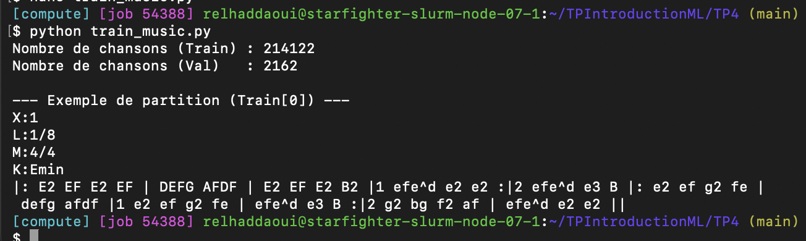

#### Question 2 : Première partition et rôle des en-têtes

```abc
X:1
L:1/8
M:4/4
K:Emin
|: E2 EF E2 EF | DEFG AFDF | E2 EF E2 B2 |1 efe^d e2 e2 :|2 efe^d e3 B |: e2 ef g2 fe |
 defg afdf |1 e2 ef g2 fe | efe^d e3 B :|2 g2 bg f2 af | efe^d e2 e2 ||
```

J'ai affiché et écouté cette partition dans ABC Player.

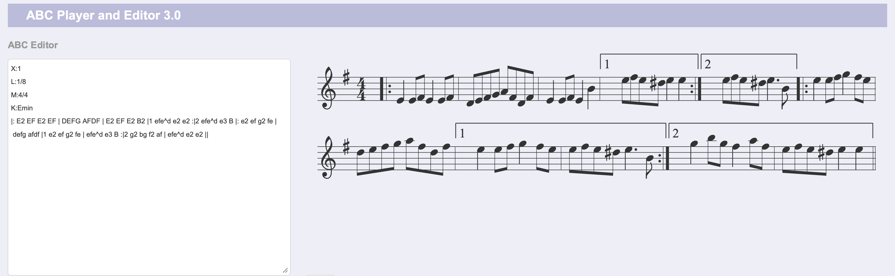

Rôle des en-têtes :

| En-tête | Signification |
| --- | --- |
| `X:1` | Numéro de référence de la partition. |
| `L:1/8` | La durée par défaut d'une note est une croche. |
| `M:4/4` | La mesure contient quatre temps, chacun valant une noire. |
| `K:Emin` | La tonalité est mi mineur. |

### Étape 2 — Vocabulaire et padding

#### Question 1 : Taille du vocabulaire et longueurs

Le vocabulaire contient **95 caractères uniques**. Dans le jeu d'entraînement, la longueur moyenne est de **290,1 caractères** et la longueur maximale est de **2 968 caractères**, avant padding et troncature.

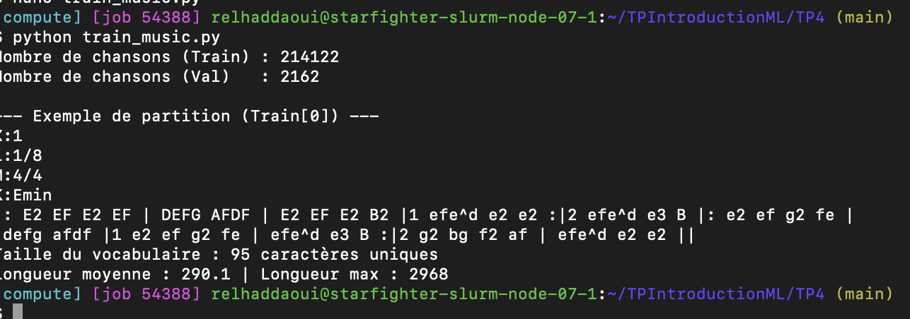

#### Question 2 : Pourquoi utiliser `sorted` ?

Un `set` supprime les doublons, mais ne garantit pas le même ordre entre deux exécutions. `sorted` permet de donner toujours le même indice à chaque caractère, si le vocabulaire reste identique.

Sans ce tri, un indice pourrait désigner `A` pendant l'entraînement puis `B` le lendemain. Les poids sauvegardés seraient alors utilisés avec de mauvaises correspondances, ce qui pourrait rendre la génération incohérente. Sauvegarder et recharger les dictionnaires avec le modèle permet aussi de conserver ces correspondances.

#### Question 3 : Pourquoi choisir 500 caractères plutôt que la longueur maximale ?

500 est un compromis entre la quantité de musique conservée et le coût du calcul. Ici, cela représente environ 1,72 fois la longueur moyenne. Les partitions plus longues sont coupées et les plus courtes sont complétées avec des espaces.

Avec un padding jusqu'à 2 968 caractères, les séquences seraient presque six fois plus longues. Le temps de calcul et la mémoire GPU nécessaire augmenteraient. Le modèle traiterait surtout beaucoup d'espaces ajoutés et apprendrait davantage à prédire du padding. La limite de 500 réduit ce gaspillage, mais supprime la fin des partitions longues.

## Exercice 2 — Dataset et architecture

### Étape 1 — MusicDataset

#### Question 1 : Dimensions de `x` et `y` et type utilisé

Chaque partition préparée contient 500 caractères. `x = seq[:-1]` enlève le dernier et `y = seq[1:]` enlève le premier : chacun contient donc 499 indices. Pour un batch complet de 128 partitions, les deux tenseurs ont la forme **`(128, 499)`**. Le dernier batch peut avoir moins de 128 exemples.

On utilise `torch.long` car les valeurs sont des indices entiers de caractères. La couche `Embedding` utilise les indices de `x` pour retrouver les représentations, et `CrossEntropyLoss` attend des indices cibles de type `torch.long` pour `y`. `torch.float32` ne convient pas à ces indices.

### Étape 2 — MusicModel

#### Question 1 : Calcul théorique des paramètres

L'Embedding contient une représentation de 256 valeurs pour chacun des 95 caractères :

`95 × 256 = 24 320 paramètres`.

Pour le RNN, on compte les poids de l'entrée, les poids de l'état caché précédent et les deux biais :

`256 × 512 + 512 × 512 + 512 + 512 = 394 240 paramètres`.

Le LSTM possède quatre ensembles de ces poids et biais : trois portes (entrée, oubli, sortie) et le calcul de la nouvelle mémoire candidate :

`4 × (256 × 512 + 512 × 512 + 512 + 512) = 1 576 960 paramètres`.

La couche finale contient les poids et un biais par caractère :

`512 × 95 + 95 = 48 735 paramètres`.

| Couche | RNN | LSTM |
| --- | ---: | ---: |
| Embedding | 24 320 | 24 320 |
| Bloc récurrent | 394 240 | 1 576 960 |
| Couche finale `fc` | 48 735 | 48 735 |
| **Total** | **467 295** | **1 650 015** |

`count_parameters` donne les mêmes totaux. Seul le bloc récurrent du LSTM a quatre fois plus de paramètres, pas le modèle entier.

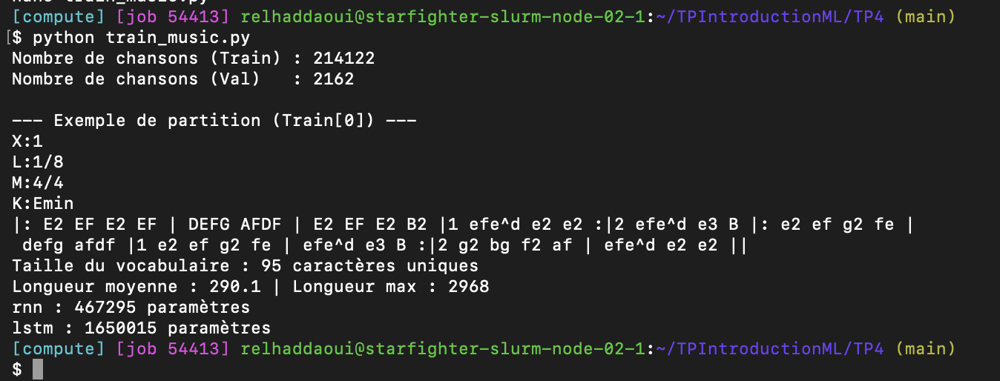

#### Question 2 : Pourquoi un Embedding plutôt qu’une couche linéaire sur l’indice ?

Les indices sont des étiquettes arbitraires. Le caractère numéro 2 ne vaut pas deux fois le caractère numéro 1. Une couche linéaire sur l'indice imposerait la relation `W × indice + biais` entre les représentations. Un Embedding apprend un vecteur propre à chaque caractère, sans imposer cette relation numérique artificielle.

#### Question 3 : Structure et rôle de `hidden_state`

Le RNN renvoie un tenseur `h`, qui résume les informations retenues dans son état caché. Le LSTM renvoie un couple `(h, c)` : `h` sert à produire la sortie et `c` est l'état de cellule, dont les portes contrôlent la conservation et la modification. Cela aide à garder des informations plus longtemps.

Avec une couche, un seul sens et un batch de 128, `h` a la forme `(1, 128, 512)`. Pour le LSTM, `c` a aussi cette forme.

## Exercice 3 — Entraînement et gradients

Les trois expériences ont été réalisées sur **10 000 partitions pendant 15 époques** : RNN sans clipping, RNN avec clipping à 1,0 et LSTM avec clipping à 1,0.

### Question 1 : Manipulation des tenseurs

`logits.reshape(-1, vocab_size)` regroupe les positions de toutes les partitions en un tableau contenant une ligne par prédiction et 95 scores par ligne. `y.reshape(-1)` rassemble les réponses attendues dans le même ordre. Cela donne les formes attendues ici par `CrossEntropyLoss`.

Pour un batch complet, les logits passent de `(128, 499, 95)` à `(63872, 95)` et les cibles de `(128, 499)` à `(63872,)`. Le `-1` est calculé automatiquement et vaut **128 × 499 = 63 872** : c'est le nombre de prédictions du batch.

### Question 2 : Ordre des opérations

`loss.backward()` calcule les gradients. Le clipping doit être effectué ensuite, quand ils existent, mais avant `optimizer.step()`, qui les utilise pour modifier les poids. Après cette mise à jour, il serait trop tard pour limiter les gradients utilisés.

### Question 3 : Analyse expérimentale (TensorBoard)

**Courbes des trois expériences**

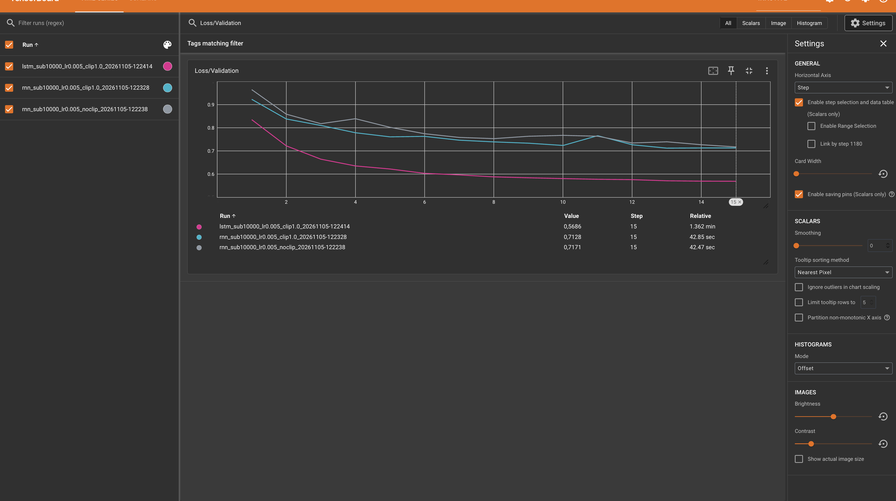

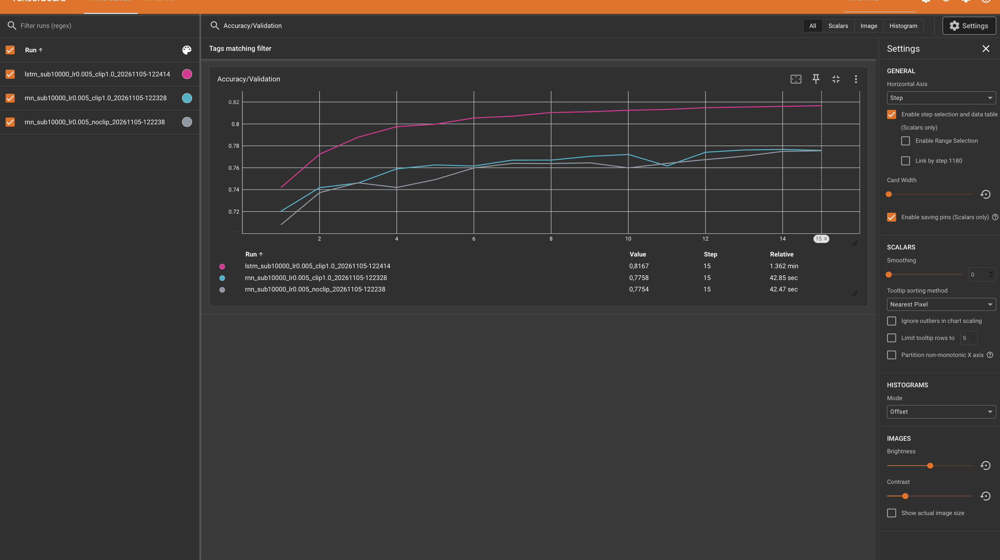

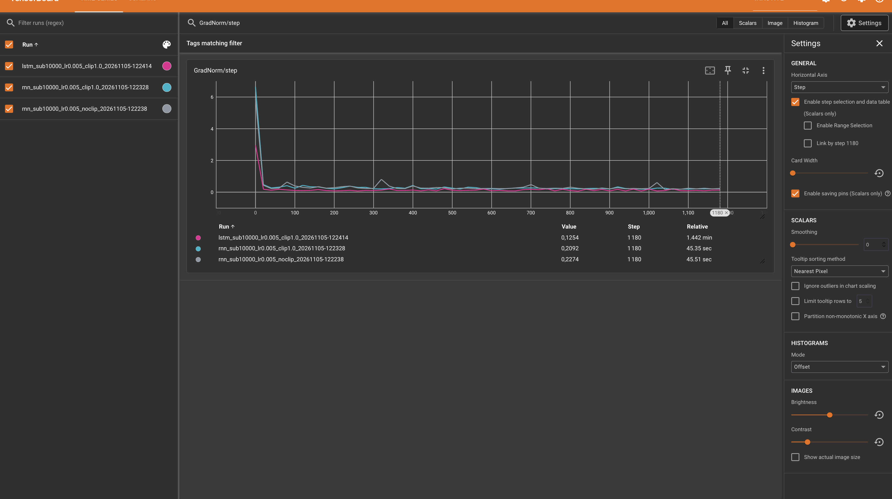

**a. Comparaison du Run 1 et du Run 2**

La norme est élevée au début puis diminue rapidement. Sur les points affichés, le RNN sans clipping présente quelques pics plus marqués. Les deux pertes diminuent globalement, avec des fluctuations dans les deux cas. Il n'y a pas de divergence durable visible et les pertes finales restent proches : **0,7171 sans clipping** et **0,7128 avec clipping**.

Le clipping limite la norme des gradients avant la mise à jour et protège contre leur explosion. Il ne corrige pas leur disparition. Les normes affichées sont mesurées **avant clipping**, donc elles peuvent dépasser 1 même pour le modèle avec clipping. Ces observations ne permettent pas d'attribuer toutes les différences au clipping : les initialisations et les ordres de batches peuvent aussi différer entre les runs.

**b. Comparaison du Run 2 et du Run 3**

| Résultat à l'époque 15 | RNN avec clipping | LSTM avec clipping |
| --- | ---: | ---: |
| Perte de validation | 0,7128 | **0,5686** |
| Précision de validation | 77,58 % | **81,67 %** |

Le LSTM gagne **4,09 points** de précision. Dès l'époque 3, il atteint 78,78 %, au-dessus du résultat final du RNN. Il atteint donc une meilleure qualité en moins d'époques. En revanche, ses époques coûtent plus cher : à l'époque 15, TensorBoard affiche environ 82 secondes pour le LSTM contre 43 secondes pour le RNN avec clipping.

La mémoire du LSTM est mise à jour par :

$$c_t = f_t \odot c_{t-1} + i_t \odot \widetilde{c}_t$$

La porte d'oubli `f_t` choisit ce qu'on conserve de l'ancienne mémoire, la porte d'entrée `i_t` contrôle l'ajout de la mémoire candidate, et la porte de sortie `o_t` contrôle l'état caché :

$$h_t = o_t \odot \tanh(c_t)$$

Sur la connexion directe de mémoire, le gradient est multiplié par `f_t`. Si cette porte reste proche de 1, l'information et le gradient peuvent mieux se conserver au fil du temps. Cette mise à jour additive atténue la disparition des gradients et aide à apprendre des dépendances longues dans les partitions.

### Question 4 : Réflexion sur la métrique

Une partition de 250 caractères complétée à 500 contient 250 espaces ajoutés. Ces espaces sont faciles à prédire et comptent dans l'accuracy. La précision peut donc être élevée sans que le modèle prédise aussi bien les notes de musique.

Pour ignorer ces espaces dans la perte :

```python
loss_fn = nn.CrossEntropyLoss(ignore_index=char_to_index[" "])
```

Cela ignore aussi les vrais espaces du texte : un symbole de padding dédié serait plus précis. Cette modification ne change pas automatiquement l'accuracy ; il faut aussi exclure le padding de son calcul.

## Exercice 4 — Génération musicale et Slurm

### Étape 1 — Génération

#### Question 1 : Efficacité algorithmique

Si on relit toute la séquence à chaque nouveau caractère, on traite une longueur croissante : `1 + 2 + ... + N`. Pour une amorce de longueur fixe, le coût total est **O(N²)**.

Avec `hidden_state`, on conserve les informations déjà calculées et on traite seulement le dernier caractère. Après la lecture de l'amorce, le coût est **O(N)** pour générer N caractères.

#### Question 2 : Rôle mathématique de la température

Lorsque `T` tend vers 0 par valeurs positives, `softmax(z/T)` se concentre sur le caractère de score maximal. Si ce maximum est unique, cela correspond au décodage glouton par `argmax`. Les choix deviennent moins variés.

Lorsque `T` tend vers l'infini, la distribution devient uniforme : chaque caractère a une probabilité de `1/95`. La génération devient plus aléatoire et peut perdre sa cohérence.

#### Question 3 : Écoute et analyse qualitative

Les trois partitions ci-dessous ont été générées avec le meilleur LSTM de l'expérience sur 10 000 partitions, à partir de l'amorce demandée. Le modèle ajoute 300 caractères à cette amorce.

Les trois textes ont été testés dans ABC Player. Après avoir retrouvé les commandes de lecture, j’ai pu écouter les trois partitions à T = 0,2, T = 0,8 et T = 2,0.

#### Température 0.2

```abc
X:1
T:Irish Reel
M:4/4
L:1/8
K:D
 a2 f d2 f | e2 d c2 A | B2 d c2 A | B2 c d2 e | f2 d c2 B | A2 A A2 f | e2 d c2 A | 
 B2 d c2 d | e2 f g2 e | f2 d e2 f | g2 g f2 e | d2 d d2 e | f2 d d2 e | f2 d d2 e | f2 d d2 :|
```

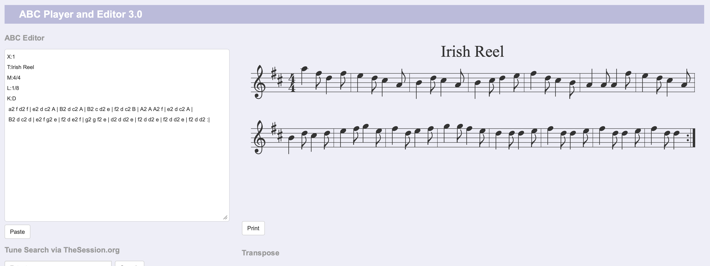

À l’écoute, la mélodie est peu variée et répète plusieurs fois les mêmes motifs, surtout vers la fin. On retrouve notamment le motif `f2 d d2 e` dans le texte ABC. Le rendu est lisible, mais plusieurs mesures ne totalisent pas les huit croches attendues en 4/4 : par exemple `a2 f d2 f` ne compte que six croches. Une basse température ne garantit donc pas une partition correcte.

#### Température 0.8

```abc
X:1
T:Irish Reel
M:4/4
L:1/8
K:D
 A3/2 d/ c>d cA d>e | f>e d4 ec | dd de dc d2 | e>d cA Bd ce | d4 || a | 
 f2 g2 g2 g2 | fd c2 A2 FG | A2 Tf2 fd B>c | d2 c2 B2 g2 | f>e d2 c2 B2 | A2 G2 F2 E2 | A>B A3 d cd | 
 AA/G/ F2 D2 G>A | B2 z d cB A2 | d2 z2 z2 d2 | c2 ce/g/ a2 gf | e2 d2 g2 z b | a2 ga/g/ fA fA | f2 e2 d2 cA | 
 c4 cc c2 |
```

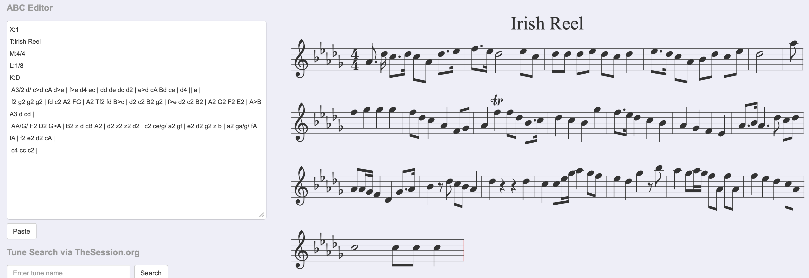

Sur la partition, les notes et les rythmes sont plus variés, avec des silences et moins de motifs répétés qu’à T = 0,2. Le texte contient notamment des silences notés `z2`. Le lecteur affiche une partition, mais les mesures ne sont pas toutes régulières : par exemple `f2 g2 g2 g2` compte les huit croches attendues, mais `d4` seul ne remplit pas une mesure complète en 4/4. Le résultat présente plus de diversité que T=0,2, sans garantir la cohérence de chaque mesure.

#### Température 2.0

```abc
X:1
T:Irish Reel
M:4/4
L:1/8
K:D
S'bxenel." a2 K:3:2anuG\xlsas\,t Qi""(4F:H ue uempo..b\OT." A,2 A3/2 A/ |!bjDE !wB .[GE.1.D(uC>.I)- [DDDek | 
!<f3AAud(uMb/4\43){aguB2.C!f+!pp! fC2B/_C/D{E}B4 | EFDB CB d>B^DE | vGB/B} d4!D.qIar2 | v>accb<gd<B :|    E  G2 a"_b" | A2b2 BA(cA) d2g2 | 
 a/a/e/A/ =G2 z{ef}|ecz(A[QBc^A/ |{g} B3vBef- f>a^
```

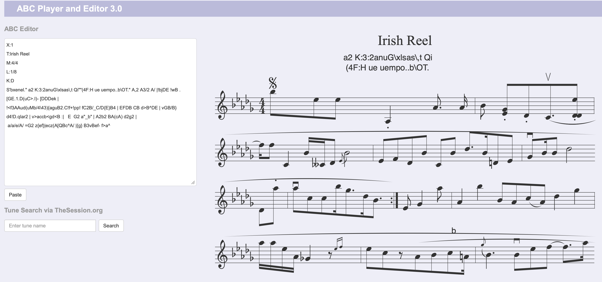

À l’écoute, le résultat paraît plus désordonné que les précédents. Le texte mélange beaucoup de symboles, de lettres et de délimiteurs mal équilibrés. Le lecteur affiche quand même des notes, mais aussi du texte parasite au-dessus des portées. La syntaxe est dégradée et la structure est beaucoup moins régulière. La forte diversité ne suffit donc pas à produire une partition cohérente.

### Étape 2 — Entraînement à plus grande échelle

**Action finale : soumission du script avec `sbatch run_music.sh`.**

Le job a été soumis avec `sbatch run_music.sh`, avec les réglages demandés :

| Paramètre | Valeur |
| --- | --- |
| Modèle | LSTM |
| `hidden_size` | 1 024 |
| `subset_size` | 50 000 |
| `max_grad_norm` | 1,0 |
| `num_epochs` | 30 maximum |
| Patience | 5 |

Le job **54494** s'est terminé avec l'état **COMPLETED**, un code de sortie **0:0** et une durée de **14 min 22 s**.

Le meilleur modèle est celui de l'époque **10** : perte de validation **0,4893**, précision **84,00 %**. L'arrêt anticipé s'est déclenché à l'époque **15**, après cinq époques sans amélioration de cette perte. À l'époque 12, un très grand pic de norme avant clipping accompagne une dégradation de la perte. Les meilleurs poids de l'époque 10 ont été rechargés avant la génération.

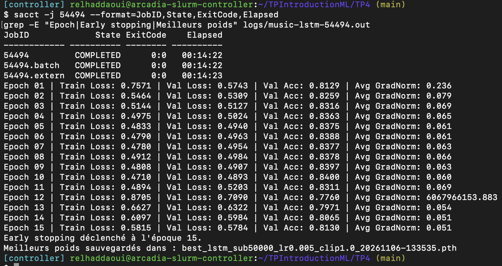

Le meilleur modèle est sauvegardé dans `best_lstm_sub50000_lr0.005_clip1.0_20261106-133535.pth`. Les trois générations sont présentes dans le journal `logs/music-lstm-54494.out` et dans les fichiers ABC suivants.

**generation_longue_T0.2.abc**

```abc
X:1
T:Irish Reel
M:4/4
L:1/8
K:D
 A | d2 dd d2 AA | B2 B B B2 B B | A2 A A B2 B B | d2 d d d2 dd | d2 dd d2 dd | d2 dd d2 z d | 
 d2 dd d2 dd | d2 dd d2 z d | d2 dd d2 dd | d2 dd d2 z d | d2 dd d2 dd | d2 dd d2 z d | c2 cc c2 Bc | 
 d2 dd d2 z2 |]
```

**generation_longue_T0.8.abc**

```abc
X:1
T:Irish Reel
M:4/4
L:1/8
K:D
 A3 A | AABA dABd | f z ed BA z B | ABAF A3 z | fedf edBd | AAAF AABA | defd e2 de | 
 f3 d efed | ef e2 d4 :| de f2 afef | dB A2 G4 | A z FA A2 de | f2 f2 feef | deff fefa | 
 afef feef | d3 a afaf | d2 f2 e3 z | defd Bcde | fefe e2 de | faa^g a2 a=a | afeg f2 fg | 
 a4 =gfed | (3efe dB BA A2 | a3
```

**generation_longue_T2.0.abc**
```abc
X:1
T:Irish Reel
M:4/4
L:1/8
K:D
|: D,d^=cd BD>G2 D2ga | fdF dedg (f"A617"f) =e2"^#".[be-Tg" [ed']4g:"A" [ge]DEfgBB e[dEe1-](G/E/)d- d2D2 k | 
"A97"{DBdub1[F\f""A\"MB2506"Em73FEfC2BriLsiousb4Tand] BGCL:1"F/DEF Wded/"d/dESF313/42E c/>uccb ud!o!ce!p.!id!e2.a"^rreKatebvOBurc][c-_gu 4adA/drderA | 8ve"{/B}|[cKis]-.Ka\n]12 
 B3vce'- f>a^
```
