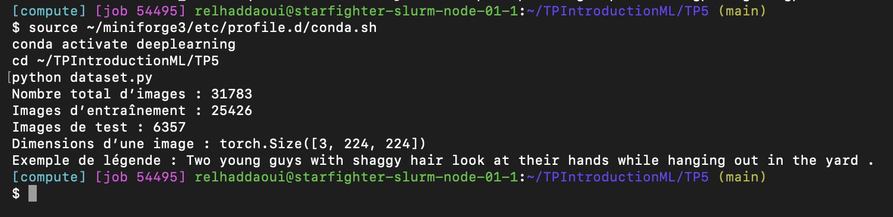
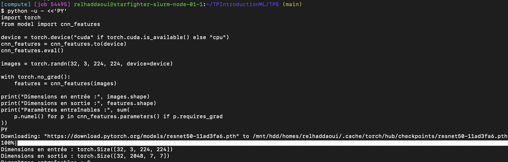
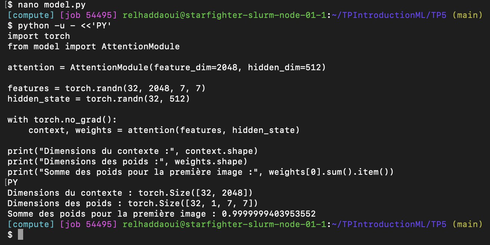
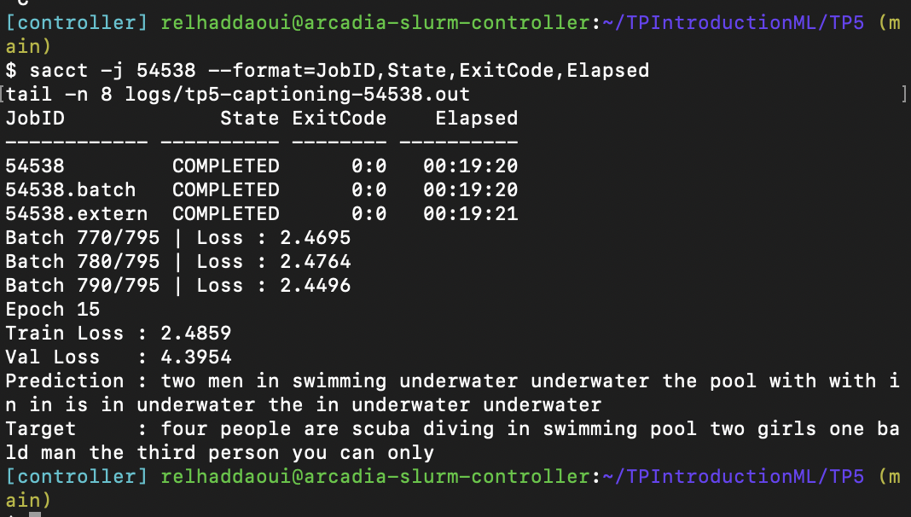
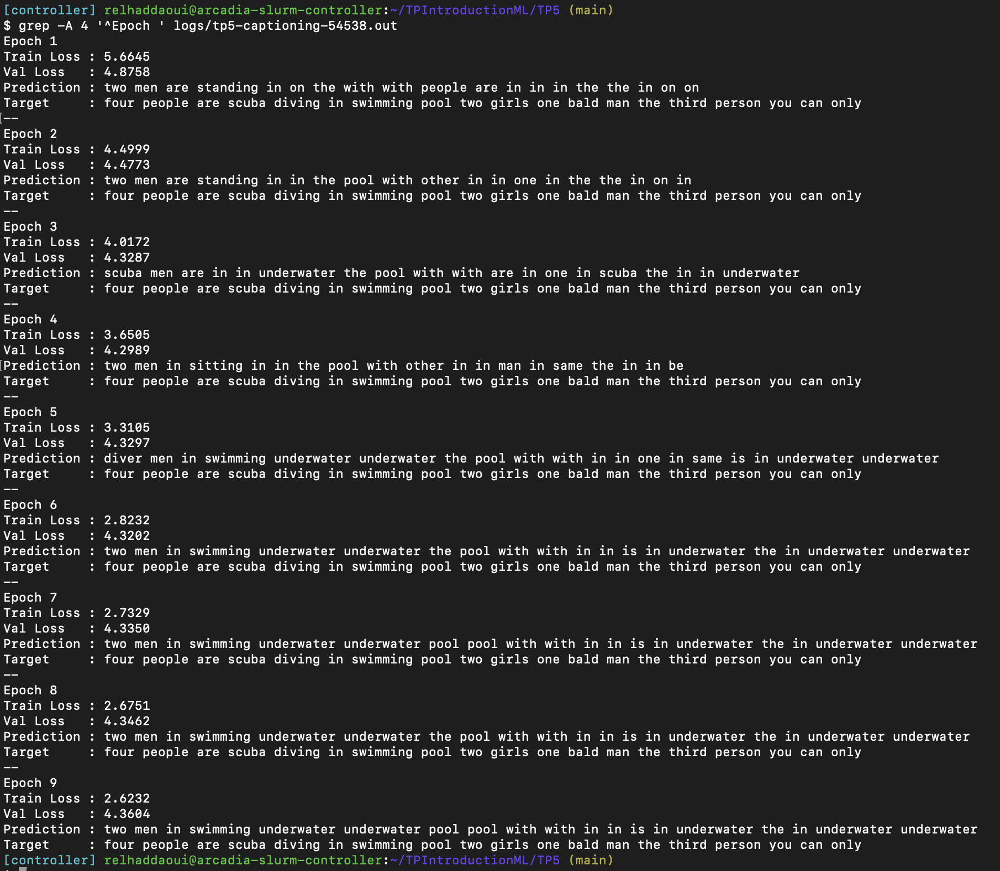
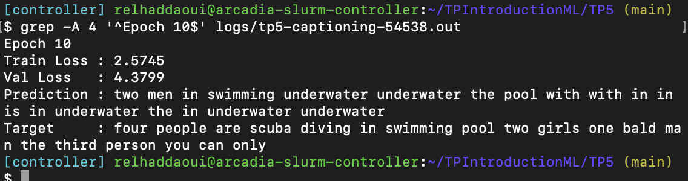
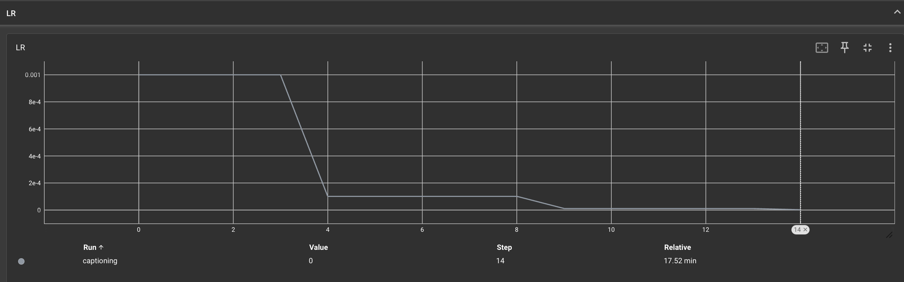
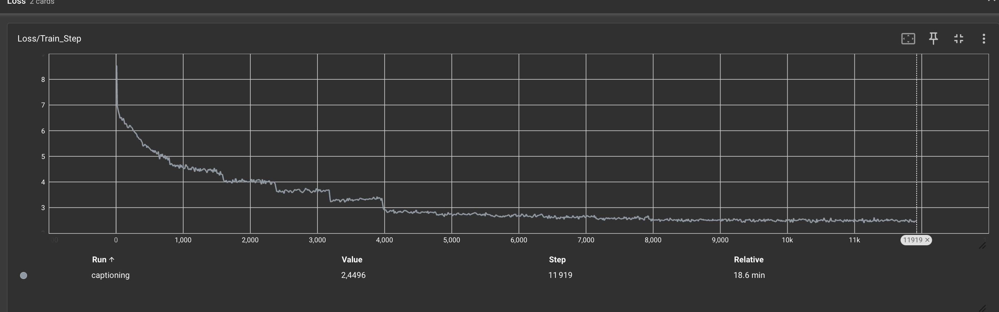
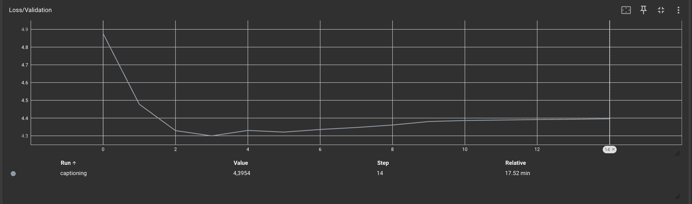

# TP5 — Image Captioning avec RNN et attention sur ResNet

## Exercice 1 — Chargement des données et embeddings

### Question 1 = Pourquoi redimensionner toutes les images à 224 × 224 ?

On met toutes les images à la même taille pour pouvoir les regrouper dans un batch. Sinon, leurs dimensions seraient différentes et on ne pourrait pas les empiler directement dans un même tenseur. Un batch de 32 images a donc la forme `(32, 3, 224, 224)`. La taille 224 × 224 correspond aussi au format de référence du ResNet pré-entraîné et évite de faire trop de calculs sur de grandes images.

## Exercice 2 — Extraction de caractéristiques et Transfer Learning

### Question 1 = Pourquoi geler les poids de ResNet ?

Pour la partie matérielle, on économise de la mémoire GPU et du temps de calcul, car on ne calcule pas les gradients de ses poids.

Pour la partie algorithmique, ResNet a déjà appris à reconnaître des caractéristiques visuelles sur ImageNet. On garde ce qu’il a appris et on limite le sur-apprentissage sur notre jeu de données. Le reste du modèle apprend à utiliser ces caractéristiques pour produire une légende.

### Question 2 = Quelle est la dimension de sortie de cnn_features ?

Pour une entrée `(32, 3, 224, 224)`, j’obtiens une sortie **`(32, 2048, 7, 7)`**. Cela correspond à 32 images, chacune découpée en une grille de 7 × 7, donc 49 régions. Chaque région est décrite par 2 048 valeurs.

## Exercice 3 — Module d’attention et LSTM personnalisé

### Question 1 = Que représente context_vector et quel problème du Seq2Seq de base résout-il ?

`context_vector` est un résumé de l’image qui donne plus d’importance aux régions utiles pour prédire le mot suivant, ce qui évite de devoir faire tenir toute l’information dans un seul résumé fixe comme dans un Seq2Seq de base.

## Exercice 4 — Modèle global et boucle d’entraînement

J’ai lancé les 15 époques avec Slurm. Le job **54538** s’est terminé correctement en **19 min 20 s**.

### Question 1 = Les légendes s’améliorent-elles entre les époques 1 et 10 ?

À l’époque 1, le modèle prédit « two men are standing », puis répète beaucoup de mots comme « with » et « in ». Cela ne décrit pas bien la légende cible, qui parle de personnes faisant de la plongée dans une piscine.

À l’époque 10, on retrouve des mots plus adaptés, comme « swimming », « underwater » et « pool ». Mais le modèle répète encore beaucoup les mêmes mots et la phrase n’est pas bien construite. Le vocabulaire est donc plus cohérent avec la scène, mais la syntaxe reste mauvaise : l’amélioration est partielle.

Comme dans le code de l’énoncé, les prédictions utilisent les mots précédents de la vraie légende en entrée.

### Question 2 = Quel est l’impact de StepLR ? Pourquoi réduire le taux d’apprentissage en fin d’entraînement ?

`StepLR(step_size=5, gamma=0.1)` divise le taux d’apprentissage par 10 toutes les cinq époques. On utilise **0,001** aux époques 1 à 5, **0,0001** aux époques 6 à 10, puis **0,00001** aux époques 11 à 15. Cela permet d’apprendre rapidement au début, puis de faire des ajustements plus petits à la fin.

Si on gardait 0,001 jusqu’au bout, les mises à jour pourraient rester trop grandes et faire osciller les poids autour d’une bonne solution, au lieu d’affiner le résultat.

Adam utilise une moyenne des gradients, comme le momentum, et une moyenne de leurs carrés, comme RMSProp. Même s’il adapte les mises à jour pour chaque poids, le taux d’apprentissage global contrôle toujours leur taille. Le diminuer aide donc à faire des ajustements plus fins en fin d’entraînement.

Le taux est enregistré après la mise à jour du scheduler en fin d’époque. La dernière valeur affichée correspond donc au taux prévu pour l’époque suivante ; son affichage arrondi à 0 ne veut pas dire qu’il est nul.

Dans mes résultats, la perte d’entraînement continue à baisser, mais celle de validation atteint environ **4,30 à l’époque 4**, puis remonte à **4,3954 à l’époque 15**. Cela suggère du sur-apprentissage : diminuer le taux d’apprentissage ne suffit pas à l’éviter. Sans faire un deuxième entraînement à taux constant, on ne peut pas mesurer exactement ce que StepLR a amélioré.
