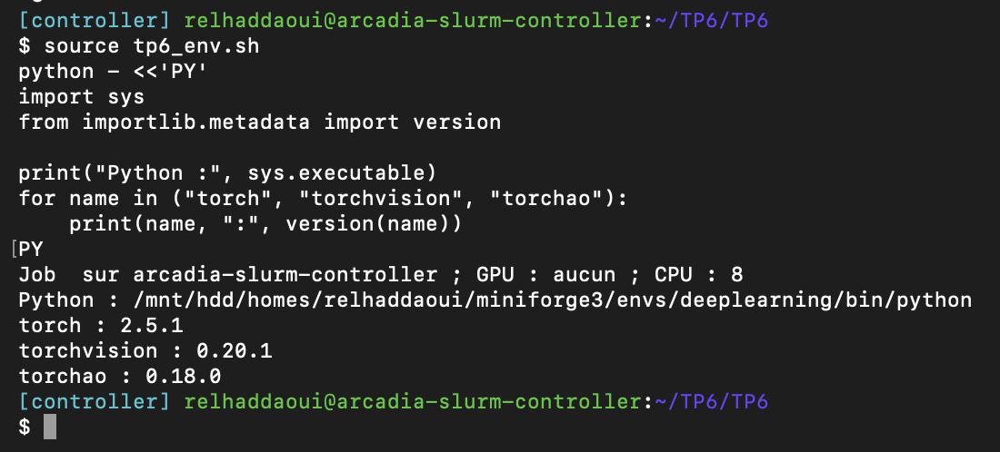
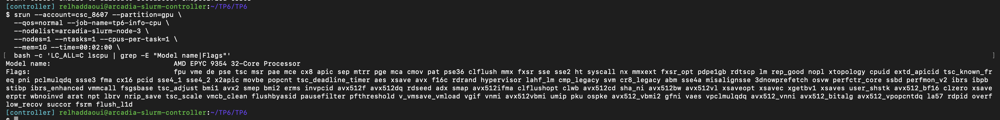
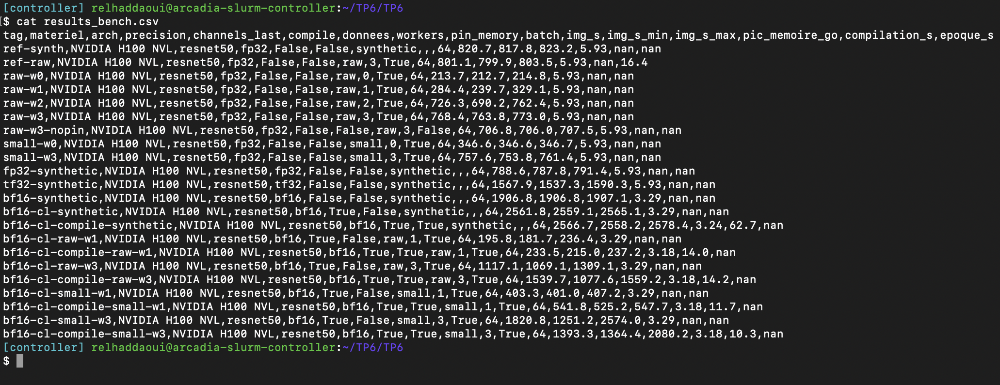
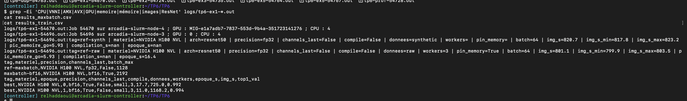
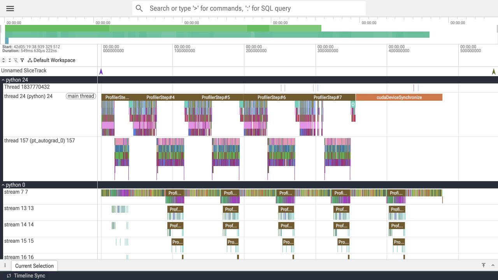
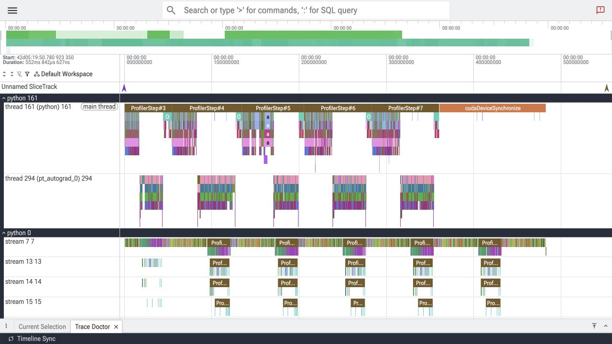
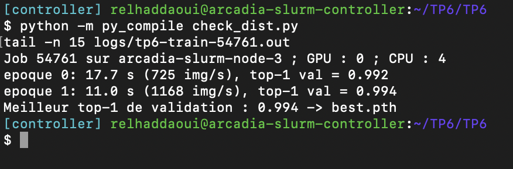
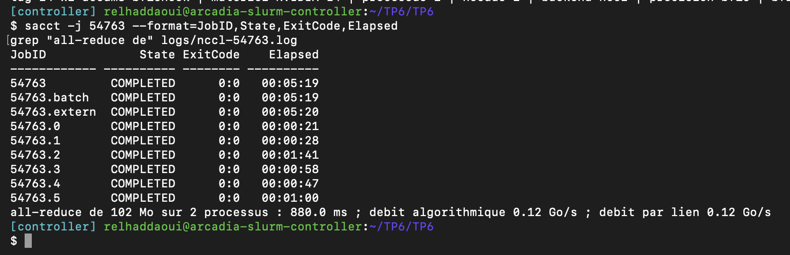
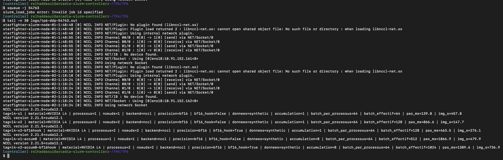
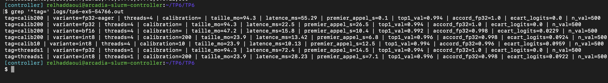

# TP6 — Accélérer un ResNet

## Exercice 0 — Mise en place

### Question 1 = Quel matériel et quelles versions sont utilisés ?

| Élément | Valeur relevée |
| --- | --- |
| GPU pour les mesures de référence et les optimisations | NVIDIA H100 NVL |
| GPU pour DDP | Deux NVIDIA L4, sur deux nœuds |
| CPU du nœud de quantification | AMD EPYC 9354 32-Core Processor |
| CPU alloués | 4 pour les exercices 1, 2, 3 et 5 ; 8 par nœud pour DDP |
| Instructions CPU utiles | `avx512_vnni` et `avx512_bf16` ; aucun indicateur `amx_*` |
| Python | 3.10 |
| PyTorch | 2.5.1 |
| torchvision | 0.20.1 |

Pour les mesures sur CPU, j’ai utilisé le nœud `arcadia-slurm-node-3`. Il reste à retrouver la capture avec la mémoire GPU totale. Le nom H100 NVL ne suffit pas pour connaître la mémoire disponible pour mon job.

J’ai aussi eu un problème avec `torchao 0.18.0` : cette version cherchait `torch.int1`, qui n’existe pas dans mon PyTorch 2.5.1. J’ai donc utilisé les fonctions de quantification PT2E déjà présentes dans `torch.ao`, sans changer la version de PyTorch.

**Capture à ajouter :** sortie de `check_env.py` ou de `nvidia-smi` montrant la mémoire GPU totale accessible au travail.





### Question 2 = Quatre CPU suffisent-ils pour alimenter le GPU ?

Avec quatre CPU, on peut garder un CPU pour le programme principal et utiliser les trois autres pour préparer les images. Si le GPU calcule plus vite que les workers ne chargent les batches, il doit attendre. Le chargement des données peut donc limiter la vitesse de l’entraînement.

## Exercice 1 — Mesure de référence

### Question 1 = Quels sont les débits, les pics mémoire et le temps d’une époque ?

J’obtiens les résultats suivants avec un batch de 64 :

| Configuration | Débit médian (images/s) | Minimum | Maximum | Pic mémoire (Go) | Temps d’une époque |
| --- | ---: | ---: | ---: | ---: | ---: |
| `ref-synth` | 820,7 | 817,8 | 823,2 | 5,93 | — |
| `ref-raw` | 801,1 | 799,9 | 803,5 | 5,93 | 16,4 s |

Avec `ref-synth`, les données sont déjà sur le GPU. Avec `ref-raw`, on charge les vraies images avec trois workers.



### Question 2 = Quel pic mémoire obtient-on avec l’estimation du cours ?

Le modèle a environ **23,5 millions de paramètres**. En FP32, chaque valeur prend quatre octets. En comptant les poids, les gradients et les deux états utilisés par AdamW, on obtient :

`23,5 millions × 4 octets × 4 = 376 Mo`.

Le cours estime aussi **84 Mo d’activations par image**. Pour un batch de 64 :

`64 × 84 = 5 376 Mo`.

Au total, cela donne **5 752 Mo, soit environ 5,75 Go**, contre **5,93 Go dans mes mesures**. Les valeurs sont du même ordre. L’écart vient notamment de la mémoire temporaire et des buffers que l’estimation ne compte pas. Il faut aussi faire attention aux unités utilisées par le compteur mémoire.


### Question 3 = Que montre ref-async et pourquoi faut-il synchroniser CUDA ?

Dans le journal du job **54696**, j’obtiens :

```text
[ref-async] retour de l'appel : 13.2 ms ; fin réelle du pas : 75.9 ms
```

Python rend donc la main au bout de **13,2 ms**, alors que le pas est réellement terminé après **75,9 ms**. Le GPU travaille de façon asynchrone : Python peut passer à la suite pendant que les calculs continuent.

Sans attendre la fin, on mesure ici un temps environ **5,75 fois trop court**. Il faut donc utiliser `torch.cuda.synchronize()` avant et après la partie chronométrée pour mesurer le vrai temps de calcul et ne pas surestimer le débit.

### Question 4 = Quel est le batch maximal FP32 et comment le comparer à l’ordre de grandeur 120 ?

J’obtiens un batch maximal de **1 128 en FP32**, contre un ordre de grandeur de 120 annoncé dans le cours. Cela fait **9,4 fois plus**.

Le batch maximal dépend de la mémoire disponible et de la configuration utilisée. Mon résultat montre donc que les conditions ne correspondent pas exactement à l’estimation du cours. Il me faut le relevé de mémoire GPU totale pour expliquer précisément cet écart.



### Question 5 = Que montre la comparaison de ref-raw et ref-synth ?

Je calcule :

`801,1 / 820,7 × 100 = 97,6 %`.

Avec les vraies images, on garde donc **97,6 % du débit obtenu sur les données synthétiques**. Avec trois workers en FP32, le chargement ralentit assez peu le programme. Le GPU passe surtout son temps à calculer.


## Exercice 2 — Chargement des données et profilage

### Question 1 = Quels débits obtient-on selon la configuration ?

Voici les débits mesurés :

| Configuration | Débit médian (images/s) |
| --- | ---: |
| `raw-w0` | 213,7 |
| `raw-w1` | 284,4 |
| `raw-w2` | 726,3 |
| `raw-w3` | 768,4 |
| `raw-w3-nopin` | 706,8 |
| `small-w0` | 346,6 |
| `small-w3` | 757,6 |


### Question 2 = Quel est l’effet des workers et pourquoi se limiter à trois avec quatre CPU ?

Sur `raw`, je passe de **213,7 images/s sans worker à 768,4 images/s avec trois workers**, soit **×3,60**. Les workers préparent les prochains batches pendant que le GPU calcule.

Avec quatre CPU alloués, on garde un CPU pour le programme principal et trois pour les workers. On peut lancer davantage de workers, mais ils devront partager les mêmes CPU. Cela risque d’ajouter de l’attente au lieu d’accélérer le chargement.


### Question 3 = Quel est l’effet de pin_memory ?

Avec trois workers, j’obtiens **706,8 images/s sans pin_memory** et **768,4 avec**, soit un gain de **8,7 %**.

`pin_memory` garde les batches dans une mémoire CPU verrouillée, ce qui facilite leur transfert vers le GPU. Avec `non_blocking=True`, ces transferts peuvent aussi se faire de façon asynchrone si les autres conditions sont réunies.


### Question 4 = Pourquoi small se charge-t-il plus vite et le modèle voit-il des images différentes ?

Sans worker, `small` atteint **346,6 images/s**, contre **213,7 pour raw**, soit **62,2 % de plus**. Les fichiers sont plus petits, donc il y a moins de données à lire, à décoder et à redimensionner.

Ce sont les mêmes exemples et les mêmes classes. Le modèle reçoit toujours des images à la taille attendue, mais les pixels peuvent être légèrement différents à cause du redimensionnement effectué à l’avance.

Avec trois workers, les débits sont proches : **757,6 pour small et 768,4 pour raw**. Dans ce cas, le chargement se fait en grande partie pendant les calculs du GPU.


### Question 5 = Quel est le temps de décodage estimé et combien d’images un worker peut-il fournir ?

J’utilise la formule du sujet : `t_d ≈ 1/D_w0 − 1/D_synth`, avec `D_synth = 820,7 images/s`.

| Source | Temps estimé par image | Capacité d’un worker | Capacité de trois workers |
| --- | ---: | ---: | ---: |
| `raw` | 3,46 ms | 289 images/s | 867 images/s |
| `small` | 1,67 ms | 600 images/s | 1 800 images/s |

D’après cette estimation, trois workers risquent de ne plus suffire si le GPU dépasse environ **867 images/s avec raw** ou **1 800 avec small**. Ce sont des valeurs approximatives : on suppose que les workers se répartissent bien le travail et ne se gênent pas entre eux. Le temps calculé comprend aussi les autres étapes de préparation des images.


### Question 6 = Que montrent les traces raw-w3 et small-w3 ?

Sur les deux traces, le flux CUDA principal est bien rempli. Les appels au DataLoader sont courts : **0,090 ms en moyenne pour raw** et **0,122 ms pour small**. On ne voit donc pas de longue attente des données dans ces captures.

Avec les débits FP32 proches du synthétique, cela fait surtout penser à une limite liée au calcul. Pour **raw-w3 comme pour small-w3**, les données ne semblent donc pas être le principal problème sur ces fenêtres. On n’a pas non plus assez d’éléments pour dire que le lancement des noyaux est la limite principale. Un trou sur un autre flux ne veut pas forcément dire que tout le GPU attend : plusieurs flux peuvent travailler en même temps.

Pour ouvrir les traces dans Perfetto, il a fallu retirer d’une copie un événement GPU de durée nulle dont la date était incorrecte, ainsi que sa liaison. Les fichiers originaux ont été gardés. Perfetto signale aussi huit événements qui se chevauchent sur `small`, sans perte de données d’après son diagnostic.





### Question 7 = Quelle fraction du débit synthétique atteint la meilleure configuration ?

La meilleure configuration de cette série est `raw-w3`, avec **768,4 images/s** :

`768,4 / 820,7 × 100 = 93,6 %`.

Elle atteint donc **93,6 % du débit synthétique**.


## Exercice 3 — Précision mixte, channels_last et torch.compile

### Question 1 = Quels sont les résultats de ex3.sh ?

Toutes les mesures utilisent un batch de 64. Le symbole « — » indique que la compilation n’est pas activée.

| Configuration | Données | Workers | Débit (images/s) | Pic mémoire (Go) | Compilation (s) |
| --- | --- | ---: | ---: | ---: | ---: |
| FP32 | Synthétiques | — | 788,6 | 5,93 | — |
| TF32 | Synthétiques | — | 1 567,9 | 5,93 | — |
| BF16 | Synthétiques | — | 1 906,8 | 3,29 | — |
| BF16 + channels_last | Synthétiques | — | 2 561,8 | 3,29 | — |
| BF16 + channels_last + compile | Synthétiques | — | 2 566,7 | 3,24 | 62,7 |
| BF16 + channels_last | raw | 1 | 195,8 | 3,29 | — |
| BF16 + channels_last + compile | raw | 1 | 233,5 | 3,18 | 14,0 |
| BF16 + channels_last | raw | 3 | 1 117,1 | 3,29 | — |
| BF16 + channels_last + compile | raw | 3 | 1 539,7 | 3,18 | 14,2 |
| BF16 + channels_last | small | 1 | 403,3 | 3,29 | — |
| BF16 + channels_last + compile | small | 1 | 541,8 | 3,18 | 11,7 |
| BF16 + channels_last | small | 3 | 1 820,8 | 3,29 | — |
| BF16 + channels_last + compile | small | 3 | 1 393,3 | 3,18 | 10,3 |


### Question 2 = Quel écart observe-t-on entre fp32-synthetic et ref-synth ?

Je calcule l’écart par rapport à la première mesure :

`(788,6 − 820,7) / 820,7 × 100 = −3,9 %`.

La deuxième mesure est donc **3,9 % plus faible**, alors que la configuration est la même. La charge du cluster et les conditions du test peuvent changer. Cela montre qu’un petit écart entre deux résultats ne suffit pas toujours à prouver qu’une option est meilleure.


### Question 3 = Quels gains apporte chaque optimisation ?

J’obtiens les gains suivants :

| Comparaison | Gain |
| --- | ---: |
| TF32 contre FP32 | ×1,99 |
| BF16 contre FP32 | ×2,42 |
| BF16 contre TF32 | ×1,22 |
| BF16 + channels_last contre BF16 | ×1,34 |
| Avec compile contre sans compile, en BF16 + channels_last | ×1,002 |
| BF16 + channels_last contre FP32 | ×3,25 |

TF32 et BF16 permettent d’utiliser les Tensor Cores, qui accélèrent les convolutions et les multiplications de matrices. BF16 réduit aussi la taille de certaines données en mémoire : le pic passe de **5,93 à 3,29 Go**, soit **44,5 % de moins**.

`channels_last` range les données d’une façon plus adaptée aux convolutions. `compile` peut regrouper plusieurs opérations et réduire le nombre de lancements. Mais dans mes résultats, son gain en plus de BF16 et channels_last est très faible : environ **0,19 %**.


### Question 4 = Où se trouve le goulot avec les données réelles et quel est le lien avec Amdahl ?

Avec les données synthétiques, le GPU atteint environ **2 562 images/s**. Les workers n’arrivent pas toujours à préparer les vraies images à cette vitesse.

Avec un worker, `raw` donne **195,8 à 233,5 images/s** et `small` **403,3 à 541,8**. Le chargement limite donc fortement le débit. Avec trois workers, les résultats s’améliorent, mais restent globalement sous le synthétique. Voici la part du débit synthétique atteinte dans chaque cas :

| Données et workers | BF16 + channels_last | BF16 + channels_last + compile |
| --- | ---: | ---: |
| raw, 1 worker | 7,6 % | 9,1 % |
| raw, 3 workers | 43,6 % | 60,0 % |
| small, 1 worker | 15,7 % | 21,1 % |
| small, 3 workers | 71,1 % | 54,3 % |

Les références synthétiques sont respectivement **2 561,8 et 2 566,7 images/s**. Dans les deux versions, raw avec un ou trois workers et small avec un worker sont surtout limités par la préparation des données. Small avec trois workers se rapproche davantage de la limite de calcul, mais reste sensible au chargement et aux variations de mesure.

L’estimation de l’exercice 2 prévoyait ce problème : **867 images/s sur raw et 1 800 sur small avec trois workers**, contre environ 2 562 images/s que le GPU peut traiter. Elle prévoit donc la tendance, mais pas les valeurs exactes : raw avec trois workers dépasse même ce seuil approximatif dans ce nouveau test.

Avec un worker, `compile` donne ici **+19,3 % sur raw** et **+34,3 % sur small**. Ce sont les différences observées entre ces exécutions, pas la preuve que la compilation accélère le chargement. Accélérer seulement le calcul ne suffit pas quand les images n’arrivent pas assez vite.

Cela rejoint la loi d’Amdahl : la partie qu’on n’accélère pas finit par limiter le gain total. Ici, chargement et calcul peuvent quand même se faire en parallèle.

Les mesures varient aussi beaucoup. Par exemple, `raw` avec un worker sans compilation varie de **181,7 à 236,4 images/s**, et `small` avec trois workers de **1 251,2 à 2 574,0**. Avec un worker, small sans compilation varie moins, de **401,0 à 407,2 images/s**, alors que raw est beaucoup plus irrégulier. Cela peut venir des coûts de préparation différents et du partage des CPU avec les autres utilisateurs. Il faut donc éviter de tirer une conclusion trop générale d’une seule valeur. Le meilleur débit réel mesuré est **1 820,8 images/s**, avec small, trois workers et sans compilation.


### Question 5 = Combien de workers faudrait-il sur une H100 entière ?

En supposant qu’une H100 entière soit sept fois plus rapide que l’instance MIG, le débit visé serait :

`7 × 2 561,8 ≈ 17 933 images/s`.

Avec les capacités estimées dans l’exercice 2, il faudrait environ **63 workers pour raw** et **30 pour small**. Trente cœurs ne suffiraient donc pas pour raw. Pour small, ce serait déjà trop juste, car il faut aussi faire tourner le programme principal. Ce calcul donne un ordre de grandeur : en pratique, le débit n’est pas forcément multiplié exactement par sept.


### Question 6 = Pourquoi la compilation est-elle plus rapide ensuite et quand est-elle amortie ?

La première compilation prend **62,7 s**. Les suivantes prennent **14,0 ; 14,2 ; 11,7 et 10,3 s**. La baisse peut s’expliquer en partie par le cache : des éléments déjà compilés peuvent être réutilisés. Ces mesures seules ne permettent pas de dire que tout l’écart vient de là.

Sur données synthétiques, un pas prend environ **24,982 ms sans compilation** et **24,935 ms avec**, soit seulement **0,0477 ms de gagnées**.

Avec ce gain, il faudrait environ **1,31 million de pas** pour rattraper les **62,7 s** de compilation. Même avec un coût réduit à **10,3 à 14,2 s**, il faudrait encore **216 000 à 298 000 pas**.

Deux époques ne représentent que **402 pas** : la compilation n’est donc pas rentable pour cet entraînement court avec les débits mesurés. Comme le gain par pas est minuscule, cette estimation reste très sensible aux variations de mesure.


### Question 7 = Quel est le gain sur le batch maximal en BF16 ?

Le batch maximal passe de **1 128 en FP32 à 2 192 en BF16 avec channels_last** :

`2 192 / 1 128 ≈ 1,94`.

On est proche d’un doublement. Ce n’est pas exactement deux, car toute la mémoire ne passe pas en BF16 : les poids, les gradients, les états d’AdamW et certains buffers restent en partie en précision supérieure. Les besoins des noyaux peuvent aussi changer selon le batch.


### Question 8 = Quels sont les résultats des deux époques et le gain contre ref-raw ?

J’ai choisi **BF16, channels_last, les images small et trois workers, sans compilation**.

| Époque affichée | Temps | Débit (images/s) | Top-1 validation |
| --- | ---: | ---: | ---: |
| `epoque 0` | 17,7 s | 725,0 | 99,2 % |
| `epoque 1` | 11,0 s | 1 168,2 | 99,4 % |

La première époque est plus lente parce qu’il faut démarrer les workers, préparer les allocations et effectuer les premières lectures. On ne peut pas séparer précisément ces coûts avec ces seuls temps. La compilation n’est pas activée ici.

Par rapport à `ref-raw`, la deuxième époque est **16,4 / 11,0 = 1,49 fois plus rapide**. Le meilleur modèle est sauvegardé dans `best.pth`, avec **99,4 % de bonnes prédictions en validation**.



## Exercice 4 — Entraînement multi-GPU avec DDP

### Question 1 = Quel transport est utilisé et quel est le débit de communication ?

Le journal affiche **`NET/Socket` et `Using network Socket`**. NCCL passe donc par le réseau Socket entre les deux nœuds, sans périphérique InfiniBand détecté.

L’all-reduce de **102 Mo** prend **880,0 ms**. Les deux débits affichés valent **0,12 Go/s**, soit environ **0,96 Gbit/s**. Cela correspond à l’ordre de grandeur d’un lien Ethernet à 1 Gbit/s, même si la mesure ne donne pas à elle seule la vitesse nominale des interfaces.





### Question 2 = Quels sont les temps, les débits, les accélérations et les efficacités ?

Je calcule `S = D₂ / D₁` en comparant les configurations avec la **même accumulation**. Pour deux GPU, l’efficacité vaut `E = S / 2`.

| Mesure | Temps par pas | Débit global (images/s) | Accélération | Efficacité |
| --- | ---: | ---: | ---: | ---: |
| A — Communication de 102 Mo | 880,0 ms | — | — | — |
| B — 1 GPU | 139,8 ms | 457,8 | Référence | — |
| C — 2 GPU | 866,6 ms | 147,7 | ×0,323 | 16,1 % |
| D — 2 GPU + hook BF16 | 463,5 ms | 276,1 | ×0,603 | 30,2 % |
| E — 1 GPU + accumulation 8 | 1 066,9 ms | 479,9 | Référence | — |
| F — 2 GPU + hook BF16 + accumulation 8 | 1 389,6 ms | 736,9 | ×1,536 | 76,8 % |

Je compare C et D à B, puis F à E. Sans accumulation, les échanges de gradients prennent trop de temps : deux GPU sont plus lents qu’un seul. Avec la compression et l’accumulation, on atteint **736,9 images/s**, contre **479,9 avec un GPU**, soit un gain de **1,54**.


### Question 3 = Combien coûte la communication des gradients et quelle part est recouverte ?

Les gradients FP32 du modèle prennent environ **94 Mo**. En partant du test sur 102 Mo :

`t_c ≈ 880 × 94 / 102 = 811 ms`.

Sur un GPU, un pas prend **139,8 ms**. Si calcul et communication se faisaient l’un après l’autre, on aurait environ **951 ms**. S’ils se recouvraient parfaitement, on serait à environ **811 ms**.

Les **866,6 ms mesurées** se trouvent entre les deux. On estime donc qu’environ `139,8 + 811 − 866,6 ≈ 84 ms` de calcul ont été cachées par la communication. Le calcul reste approximatif, car DDP envoie les gradients en plusieurs groupes.


### Question 4 = Quel est l’effet du hook BF16 et quel risque prend-on ?

Le hook envoie les gradients en BF16. Ils prennent environ deux fois moins de place à transmettre. Le temps par pas passe de **866,6 à 463,5 ms**, ce qui multiplie le débit par **1,87**.

En échange, les gradients sont arrondis avec moins de précision. Cela peut modifier l’apprentissage, donc il faut vérifier que le modèle converge toujours correctement.


### Question 5 = Pourquoi Amdahl ne suffit-il pas et que prédit le modèle avec accumulation ?

La loi d’Amdahl ne suffit pas ici, car ajouter un nœud ajoute aussi des échanges réseau et change le batch global. Avec l’accumulation, on change en plus le nombre de communications par image.

Pour huit micro-batches, avec la compression BF16 et le temps de recouvrement estimé à la question 3 :

`T₂ ≈ 8 × 139,8 + 811 / 2 − 84 ≈ 1 440 ms`.

Je mesure **1 389,6 ms**, soit environ **3,6 % de moins**. Le modèle donne donc une estimation assez proche. Ce calcul a été fait après avoir lu les résultats, pas avant la mesure.


### Question 6 = Quand le DDP devient-il rentable et quels leviers peut-on utiliser ?

À batch local identique, le DDP devient intéressant si deux GPU mettent moins de deux fois le temps d’un GPU pour traiter leur batch global. Ici, avec la même accumulation :

`1 389,6 ms < 2 × 1 066,9 ms`.

La configuration F est donc plus rapide en débit. On peut réduire les échanges en compressant les gradients, mais on perd de la précision numérique. On peut aussi accumuler les gradients pour communiquer moins souvent, mais cela augmente le batch effectif et espace les mises à jour. Un réseau plus rapide aiderait également.


### Question 7 = Comment adapter le taux d’apprentissage au batch effectif ?

Le batch effectif passe de **64 à 128**, puis à **1 024** avec l’accumulation. Il faut donc revoir le taux d’apprentissage au lieu de garder automatiquement les mêmes réglages.

Avec SGD, une règle courante consiste à multiplier le taux par le même facteur que le batch, avec une montée progressive au début. Par rapport au batch 64, cela donne **×2 pour le batch 128**, puis **×16 pour le batch 1 024**.

Avec AdamW, on peut essayer une augmentation selon la racine carrée de ce facteur, plutôt qu’une augmentation linéaire automatique : **×√2 ≈ 1,41 pour le batch 128** et **×√16 = 4 pour le batch 1 024**, toujours par rapport au batch 64.

Ce sont des points de départ : il faut vérifier la convergence, la précision et le nombre de mises à jour obtenues.


### Question 8 = Pourquoi la même graine, des données différentes, set_epoch et no_sync ?

La même graine permet de partir avec les mêmes poids sur tous les processus. Par contre, chaque processus doit traiter des données différentes pour que le batch global contienne de nouveaux exemples. Pour les données synthétiques, on utilise donc `seed + rank`.

`sampler.set_epoch(epoch)` change l’ordre des données à chaque époque. Sans cet appel, on répéterait le même mélange.

`model.no_sync()` évite d’envoyer les gradients à chaque micro-batch pendant l’accumulation. Sans lui, chaque backward lancerait une communication, ce qui ferait perdre une grande partie du gain.

## Exercice 5 — Quantification INT8 sur CPU

### Question 1 = Quels résultats obtient-on pour calib200 ?

Je garde uniquement les résultats du **job 54766**, pour ne pas mélanger plusieurs exécutions. On traite une image à la fois et on évalue la précision sur 500 images. La latence est la médiane de cinquante appels, après dix appels de chauffe.

| Variante avec 4 threads | Poids (Mo) | Latence (ms) | Premier appel (s) | Top-1 |
| --- | ---: | ---: | ---: | ---: |
| FP32 sans compilation | 94,3 | 55,29 | 0,1 | 99,4 % |
| FP32 compilé | 94,3 | 22,50 | 26,5 | 99,4 % |
| BF16 compilé | 47,2 | 15,80 | 10,4 | 99,2 % |
| INT8 compilé | 23,9 | 13,42 | 6,8 | 99,6 % |

Le premier appel comprend la compilation éventuelle. En revanche, l’export et la calibration INT8 sont faits avant et ne sont pas inclus dans ce temps.



### Question 2 = Pourquoi la taille n’est-elle pas exactement divisée par quatre ?

Je calcule `94,3 / 23,9 = 3,95`. Les poids INT8 sont donc **3,95 fois plus petits**.

On n’obtient pas exactement quatre, car certains tenseurs restent dans une précision plus élevée et il faut ajouter les paramètres de quantification, comme les échelles.

Le modèle converti garde aussi des poids d’origine qui ne servent plus au calcul. Si on comptait tout son `state_dict`, la taille serait surestimée. `weights_mb` compte seulement les tenseurs utilisés par les nœuds `get_attr` du graphe.


### Question 3 = Comment comparer les latences et quel est le rôle des instructions CPU ?

La compilation accélère déjà FP32 de **55,29 / 22,50 = 2,46 fois**. Pour mesurer ce qu’apporte INT8, il faut donc le comparer au **FP32 compilé** :

`22,50 / 13,42 = 1,68`.

INT8 est donc **1,68 fois plus rapide**. BF16 est **1,42 fois plus rapide** que FP32 compilé.

Le CPU possède `avx512_vnni`, utile pour les calculs entiers, et `avx512_bf16`. Il n’affiche pas d’instructions AMX. Cela est cohérent avec les gains observés, mais la liste des instructions disponibles ne prouve pas lesquelles ont réellement été utilisées.


### Question 4 = Quel est l’effet sur la précision et quel rôle joue la calibration ?

Voici les résultats sur les 500 images :

| Variante | Top-1 | Accord avec FP32 | Écart moyen des logits |
| --- | ---: | ---: | ---: |
| FP32 | 99,4 % | 100 % | 0 |
| BF16 | 99,2 % | 99,8 % | 0,0229 |
| INT8 avec 200 images de calibration | 99,6 % | 99,8 % | 0,0924 |
| INT8 avec 10 images de calibration | 99,4 % | 99,6 % | 0,0959 |

INT8 avec 200 images de calibration atteint **99,6 %**, contre **99,4 % en FP32**. Cela ne fait qu’une image correcte de plus : on ne peut pas en déduire qu’INT8 améliore vraiment le modèle.

Avec seulement dix images de calibration, l’accord avec FP32 baisse et les scores de sortie, ou logits, s’écartent un peu plus. La calibration sert à observer les valeurs des activations pour choisir les paramètres de quantification. Le top-1 seul ne suffit donc pas à juger le résultat, surtout quand il est déjà proche de 100 %.


### Question 5 = Quel est l’effet du passage de un à quatre threads ?

| Variante | 1 thread | 4 threads | Accélération |
| --- | ---: | ---: | ---: |
| FP32 compilé | 72,40 ms | 22,50 ms | ×3,22 |
| INT8 compilé, calibration 200 | 28,23 ms | 13,42 ms | ×2,10 |

Passer de un à quatre threads accélère FP32 de **3,22 fois** et INT8 de **2,10 fois**. On ne va donc pas quatre fois plus vite.

Les threads doivent se synchroniser et partager la mémoire, et certaines opérations se répartissent moins bien. Pour le déploiement, il faut choisir le nombre de threads en fonction du besoin : en utiliser plus pour une requête peut laisser moins de ressources pour en traiter plusieurs en même temps.


### Question 6 = Pourquoi une quantification dynamique aurait-elle peu d’effet sur ResNet ?

La quantification dynamique classique agit surtout sur les couches linéaires. Dans ResNet, une grande partie des calculs vient des convolutions : le gain serait donc limité.

La quantification statique utilisée dans ce TP calibre les activations et permet aussi de quantifier ces convolutions.

## Rapport final — Synthèse

### Question 1 = Comment comparer toutes les configurations mesurées ?

Le tableau regroupe les résultats obtenus. Les lignes « entraînement court » correspondent à des époques complètes. Les autres mesures d’entraînement sont des benchmarks sur plusieurs pas. « Non mesuré » signifie que je n’ai pas de valeur pour cette expérience.

| Configuration | Matériel | Données | Débit (images/s) | Pic mémoire GPU (Go) | Temps par époque (s) |
| --- | --- | --- | ---: | ---: | ---: |
| Référence FP32 synthétique | H100 NVL | Synthétiques | 820,7 | 5,93 | — |
| Référence FP32 réelle, 3 workers | H100 NVL | raw | 801,1 | 5,93 | 16,4 |
| FP32, 0 worker | H100 NVL | raw | 213,7 | 5,93 | — |
| FP32, 1 worker | H100 NVL | raw | 284,4 | 5,93 | — |
| FP32, 2 workers | H100 NVL | raw | 726,3 | 5,93 | — |
| FP32, 3 workers | H100 NVL | raw | 768,4 | 5,93 | — |
| FP32, 3 workers, sans pin_memory | H100 NVL | raw | 706,8 | 5,93 | — |
| FP32, 0 worker | H100 NVL | small | 346,6 | 5,93 | — |
| FP32, 3 workers | H100 NVL | small | 757,6 | 5,93 | — |
| FP32, seconde série | H100 NVL | Synthétiques | 788,6 | 5,93 | — |
| TF32 | H100 NVL | Synthétiques | 1 567,9 | 5,93 | — |
| BF16 | H100 NVL | Synthétiques | 1 906,8 | 3,29 | — |
| BF16 + channels_last | H100 NVL | Synthétiques | 2 561,8 | 3,29 | — |
| BF16 + channels_last + compile | H100 NVL | Synthétiques | 2 566,7 | 3,24 | — |
| BF16 + channels_last, 1 worker | H100 NVL | raw | 195,8 | 3,29 | — |
| BF16 + channels_last + compile, 1 worker | H100 NVL | raw | 233,5 | 3,18 | — |
| BF16 + channels_last, 3 workers | H100 NVL | raw | 1 117,1 | 3,29 | — |
| BF16 + channels_last + compile, 3 workers | H100 NVL | raw | 1 539,7 | 3,18 | — |
| BF16 + channels_last, 1 worker | H100 NVL | small | 403,3 | 3,29 | — |
| BF16 + channels_last + compile, 1 worker | H100 NVL | small | 541,8 | 3,18 | — |
| BF16 + channels_last, 3 workers | H100 NVL | small | 1 820,8 | 3,29 | — |
| BF16 + channels_last + compile, 3 workers | H100 NVL | small | 1 393,3 | 3,18 | — |
| Entraînement court BF16, première époque | H100 NVL | small | 725,0 | Non mesuré | 17,7 |
| Entraînement court BF16, deuxième époque | H100 NVL | small | 1 168,2 | Non mesuré | 11,0 |
| BF16 + channels_last, 1 GPU | 1 L4 | Synthétiques | 457,8 | Non mesuré | — |
| BF16 + channels_last, 2 GPU | 2 L4 | Synthétiques | 147,7 | Non mesuré | — |
| BF16 + channels_last, 2 GPU, hook BF16 | 2 L4 | Synthétiques | 276,1 | Non mesuré | — |
| BF16 + channels_last, 1 GPU, accumulation 8 | 1 L4 | Synthétiques | 479,9 | Non mesuré | — |
| BF16 + channels_last, 2 GPU, hook BF16, accumulation 8 | 2 L4 | Synthétiques | 736,9 | Non mesuré | — |

Pour l’inférence, je compare surtout la latence d’une image et la taille des poids. Ce n’est pas le même travail que l’entraînement : il n’y a ni backward ni mise à jour des poids.

| Variante CPU | Threads | Calibration | Latence par image (ms) | Poids (Mo) | Top-1 |
| --- | ---: | ---: | ---: | ---: | ---: |
| FP32 sans compilation | 4 | — | 55,29 | 94,3 | 99,4 % |
| FP32 compilé | 4 | — | 22,50 | 94,3 | 99,4 % |
| BF16 compilé | 4 | — | 15,80 | 47,2 | 99,2 % |
| INT8 compilé | 4 | 200 | 13,42 | 23,9 | 99,6 % |
| INT8 compilé | 4 | 10 | 10,13 | 23,9 | 99,4 % |
| FP32 compilé | 1 | — | 72,40 | 94,3 | 99,4 % |
| INT8 compilé | 1 | 200 | 28,23 | 23,9 | 99,6 % |

Les mesures CPU proviennent du même job 54766, sur l’AMD EPYC 9354. Le temps par époque et le pic mémoire GPU ne s’appliquent pas à ces mesures d’inférence sur CPU.


### Question 2 = Pourquoi le DDP n’atteint-il pas une accélération idéale de deux ?

Avec un GPU, je mesure **457,8 images/s**. Avec deux GPU sans accumulation, le débit descend à **147,7 images/s**. Le test réseau aide à comprendre ce résultat : un échange de **102 Mo prend 880 ms**, alors qu’un pas sur un GPU ne prend que **139,8 ms**. Les échanges de gradients coûtent donc plus cher que le calcul local.

Le modèle de communication donne environ **811 ms pour 94 Mo de gradients**, avec environ **84 ms de calcul cachées par les échanges**. Le hook BF16 réduit ce coût en envoyant moins de données. Avec huit micro-batches accumulés, on communique moins souvent et le débit passe de **479,9 images/s sur un GPU à 736,9 sur deux**, soit **×1,54 au lieu de ×2**.

Ces benchmarks DDP utilisent des données synthétiques déjà sur le GPU. Le chargement des images n’explique donc pas leur perte d’efficacité. En revanche, DDP doit synchroniser les processus : les plus rapides attendent les plus lents et les échanges ajoutent du temps. Nos mesures ne séparent pas précisément cette attente du coût de communication. Je ne peux donc pas donner une part chiffrée indépendante pour chacun.


### Question 3 = Quelle configuration choisir pour entraîner puis déployer le modèle ?

Pour cet entraînement court sur le cluster, je choisirais **une H100, BF16, channels_last, les images small, trois workers et pin_memory**, avec un batch de 64 et **sans compilation**. Cette configuration donne le meilleur débit réel médian de la série, **1 820,8 images/s**, même si les répétitions varient beaucoup. La deuxième époque complète prend **11,0 s**, contre **16,4 s pour la référence FP32**. La compilation apporte très peu sur le synthétique et coûte trop de temps pour seulement deux époques.

Je garderais un seul GPU pour ce cas. Sur les L4, deux GPU sans accumulation sont plus lents qu’un seul à cause du réseau. L’accumulation avec compression améliore le débit, mais change le batch global et demande de revoir les réglages d’apprentissage. Les comparaisons de débit entre H100 et L4 ne mesurent pas l’effet du seul nombre de GPU, car les cartes sont différentes.

Pour le déploiement CPU, je choisirais **INT8 compilé avec 200 images de calibration**. Avec quatre threads, il utilise **23,9 Mo de poids**, traite une image en **13,42 ms** et garde **99,6 % de top-1** sur les 500 images évaluées. Les poids sont **3,95 fois plus petits** et l’inférence **1,68 fois plus rapide** qu’en FP32 compilé. Je retiens 200 images plutôt que dix, car l’accord avec FP32 est meilleur. Le choix de quatre threads serait ensuite à vérifier selon le nombre de requêtes à traiter en même temps.


